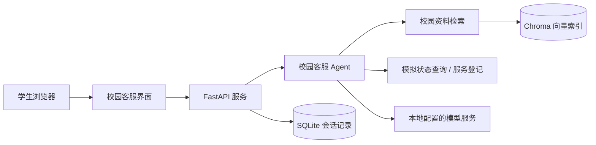

# 长安大学校园智能客服助手

面向校园常见咨询的课程项目，提供公开资料问答、模拟办事状态查询和模拟人工服务登记。工程版界面只提供校园客服功能，运行配置、依赖安装和最终验证均以 Windows 11 为准。

## 功能范围

- **校园知识问答**：检索整理后的长安大学公开资料，在回答中列出来源链接；政策文件的历史版本和适用范围会保留说明。
- **办事状态查询**：按所选演示身份查询本地合成记录，不连接教务、学工或真实学生账户。
- **人工服务登记**：创建课程演示用本地服务单，不会联系真实工作人员。
- **对话记录**：工程版由服务端 SQLite 保存会话；侧栏可浏览和删除当前会话。校园 Agent 的模型上下文最多使用最近四轮。
- **双路线实验**：Python 原理版展示显式 RAG 与工具注册；工程版展示 LangGraph、FastAPI、校园工具和浏览器聊天界面。两条路线的运行证据各自保存。

## Windows 11 启动工程版

在 PowerShell 进入项目根目录后运行：

```powershell
uv sync --frozen
.\.venv\Scripts\python.exe scripts\launch_local_demo_windows.py
```

启动器在本机启动 API 与 Streamlit 页面并打开默认浏览器，页面地址为 `http://127.0.0.1:8501`。也可在两个 PowerShell 窗口分别运行：

```powershell
.\.venv\Scripts\python.exe src\run_service.py
```

```powershell
.\.venv\Scripts\streamlit.exe run src\streamlit_app.py
```

模型服务需由项目运行者在本地 `.env` 中自行配置。不要把 `.env`、真实学生资料或服务凭据放进交付包。所有状态与服务单演示只使用 `SIM-USER-*` 等合成数据。

## 主要模块

```text
src/agents/campus_customer_service.py  校园客服工作流
src/campus/                            校园资料加载、切块、向量检索与业务工具
src/service/                           FastAPI 服务端
src/client/                            Streamlit 使用的服务客户端
src/streamlit_app.py                   校园客服中文界面
src/schema/                             请求、消息与配置结构
data/campus/                            固定公开资料及模拟业务种子数据
docs/campus/                            来源清单、索引与实验说明
tests/campus/                           校园模块测试
tests/app/                              浏览器应用逻辑测试
scripts/                                Windows 启动、评测与交付脚本
reports/                                运行记录、对照实验与报告草稿
submission/                             六类课程交付材料
```

系统主要调用关系：



## 验收入口

- `reports/demo_script.md`：知识问答、模拟状态、第二轮服务登记与未知问题演示脚本。
- `reports/requirements_matrix.md`：课程要求与实现/证据映射。
- `submission/06_Demo/screenshots/`：真实运行页面截图；截图用于展示界面，不代替 Coze 平台结果或人工现场验收。
- `reports/评分表_V1_V2.csv`：按统一 Rubric 对 10 份已保存回答评分，含评分者、逐项理由和 trace。

## 工程来源和许可

工程版复用了公开 MIT 工程基础中的服务、消息协议和依赖骨架，并将工作流、检索、校园工具、演示界面和课程实验材料改造成校园客服项目。固定来源提交、保留范围与自研内容记录在 [`UPSTREAM.md`](UPSTREAM.md)；原 [`LICENSE`](LICENSE) 随工程版保留。课程是否允许复用该工程骨架仍以教师意见为准，当前材料没有宣称已获许可。
