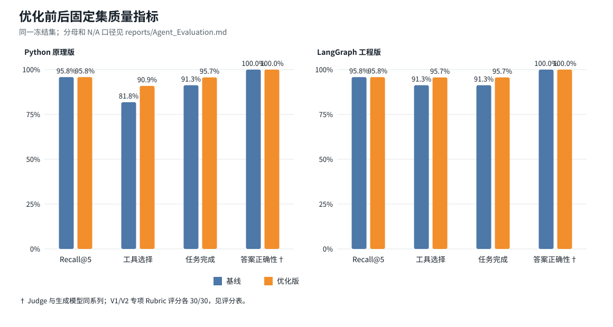
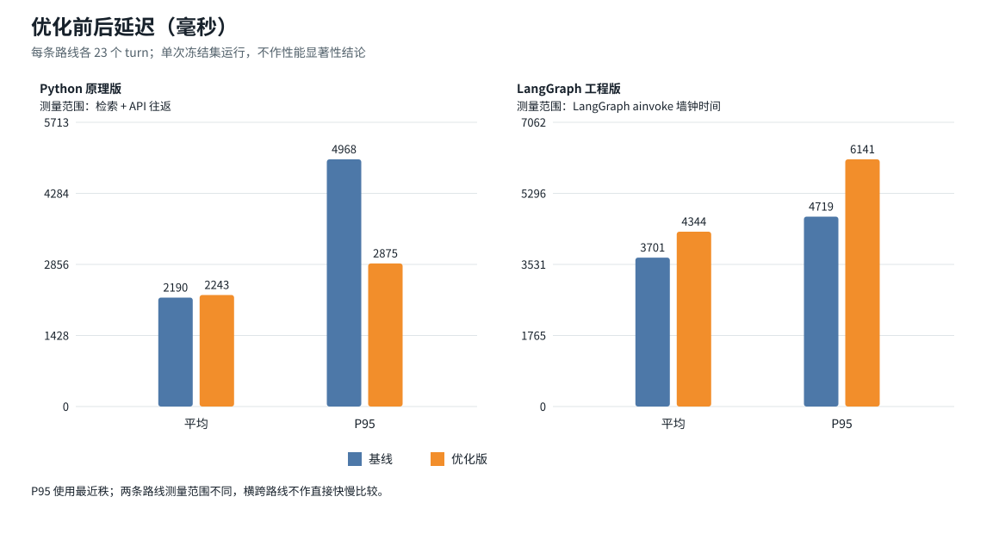

# 校园 Agent 冻结集基线与优化评测

日期：2026-10-06（Asia/Shanghai）  
我用冻结集 `campus-customer-service-frozen-v1` 对两条路线分别做了基线和优化版评测。每条路线包含 21 个用例、23 个 assistant turn；四组运行都有完整逐轮 trace，也都没有执行错误。评测期间保持用例、来源和答案标准不变，只调整了实现和身份上下文处理。

## 结果对照

| 路线 / 指标 | 基线 | 优化版 | 变化 |
|---|---:|---:|---:|
| Principles Retrieval Recall@5（12 turn） | 11.5/12 = 0.9583 | 11.5/12 = 0.9583 | 无变化 |
| Principles MRR@5 | 1.0000 | 1.0000 | 无变化 |
| Principles Tool Selection | 9/11 = 0.8182 | 10/11 = 0.9091 | +9.1 个百分点 |
| Principles Tool Argument | 6/8 = 0.7500 | 5/8 = 0.6250 | −12.5 个百分点 |
| Principles Task Completion | 21/23 = 0.9130 | 22/23 = 0.9565 | +4.3 个百分点 |
| Engineering Retrieval Recall@5（12 turn） | 11.5/12 = 0.9583 | 11.5/12 = 0.9583 | 无变化 |
| Engineering MRR@5 | 1.0000 | 1.0000 | 无变化 |
| Engineering Tool Selection | 21/23 = 0.9130 | 22/23 = 0.9565 | +4.3 个百分点 |
| Engineering Tool Argument | 6/8 = 0.7500 | 6/8 = 0.7500 | 无变化 |
| Engineering Task Completion | 21/23 = 0.9130 | 22/23 = 0.9565 | +4.3 个百分点 |
| Answer Correctness（每路线 Judge 2/2） | 23/23 = 1.0000 | 23/23 = 1.0000 | 无变化 |
| Answer Faithfulness（每路线 Judge 2/2） | 23/23 = 1.0000 | 23/23 = 1.0000 | 无变化 |
| Citation Accuracy（有来源的 12 turn） | 12/12 = 1.0000 | 12/12 = 1.0000 | 无变化 |
| Unknown Handling | 2/2 | 2/2 | 无变化 |

## 结果分析

- **S04 无身份查询**：基线中两条路线都调用了 `query_application_status`，随后被数据库以 `invalid_identity` 拒绝。优化后，模型在没有演示身份时会先要求配置身份，不再调用个人状态工具；两条路线的任务完成数都从 21/23 增至 22/23。逐轮记录见 Principles `runs/principles-20261006-194840-7fd3833c/trace.json` 和 Engineering `runs/engineering-case-20261006-195429-05c1ce10/traces/turn_01.json`。
- **B01 跨用户查询**：两版都直接拒绝了越权请求，没有按评分标准调用状态工具。这个安全行为与冻结集 gold 对“工具调用”的要求不一致，因此该项差异仍保留；我没有为了得分放宽跨用户访问限制。
- **工具参数**：S01 两版都省略了 gold 中的 `service_type`，但服务端仍根据当前合成身份和记录号查到正确状态。Principles 优化版在 S05 也省略了该字段，虽正确返回 `not_found`，严格参数得分仍从 6/8 降到 5/8。
- **U02 检索**：两路线的基线和优化版都只检索到 `international_off_campus_housing_2017`，Recall@5 为 0.5。该办法只适用于来华国际学生，当前语料没有适用于国内本科生的现行住宿流程，所以我保留了这个未解决问题。K01、K10 和 U02 的失败分析见失败报告；前两项已有修复后的记录。
- **回答评分**：自动 Judge 使用 DeepSeek `deepseek-flash`，与生成模型同系列。两版各完成 46 份 Judge 输入；Citation 只对有 gold 来源的 12 轮计分，其余 11 轮为 N/A。另有 10 份 V1/V2 回答按统一 Rubric 评分，两版各 30/30，分项理由和 trace 见 `reports/评分表_V1_V2.csv`。

## 延迟与 Windows 测试

| 路线 | 基线平均 / P95 | 优化版平均 / P95 | 采样 |
|---|---:|---:|---:|
| Principles | 2189.6 / 4968 ms | 2242.6 / 2875 ms | 各 23 turns |
| Engineering | 3701.1 / 4719 ms | 4343.8 / 6141 ms | 各 23 turns |

P95 使用最近秩。Principles 记录检索和 provider 往返时间；Engineering 记录 LangGraph `ainvoke` 的完整墙钟时间，两个口径不同，不能直接横向比较。每版只运行过一次，网络和服务波动也会影响结果，因此我只报告测得的数值，不把它解释成优化带来的性能变化。

Windows 全量测试在修复前为 237 passed / 1 failed / 4 skipped。修正 Streamlit 对可选 `agent_config` 的调用并加入身份边界用例后，结果为 241 passed / 0 failed / 4 skipped / 18 warnings，用时 53.99 秒。4 项 Docker 测试因环境标记跳过；两次测试用例数量不同，我没有直接比较通过率。

### 后续配置隔离回归（不重跑 Agent 评测）

报告初稿之后，我又加入了 `.env` 路径回归用例，检查从独立交付目录启动时是否会误读上级目录中的开发密钥。加入该用例后，Windows Python 3.12.7 环境的全量测试为 242 passed / 0 failed / 4 skipped / 18 warnings，用时 41.66 秒。Agent 冻结集和 46 条 Judge 没有重跑，所以上面的评测指标仍对应原始运行。独立工程包按锁文件在 Python 3.13.14 下复测，结果为 242 passed / 4 skipped，用时 55.84 秒。

## 可重算的原始工件

- 基线汇总：`runs/frozen-eval-v1-20261006/metric_results.json`
- 优化汇总：`runs/frozen-eval-optimized-v1-20261006/metric_results.json`
- 基线逐轮单位与 Judge 输入：同目录 `principles_units.jsonl`、`engineering_units.jsonl`、`judge_input.jsonl`、`judgements.jsonl`、`judge_raw/`
- 优化版同名逐轮工件：`runs/frozen-eval-optimized-v1-20261006/`
- 父级按例索引与 manifest：`runs/baseline-principles-v1-20261006/`、`runs/baseline-engineering-v1-20261006/`、`runs/baseline-optimized-principles-v1-20261006/`、`runs/baseline-optimized-engineering-v1-20261006/`
- 指标口径：`evaluation/metric_spec_v1.json`
